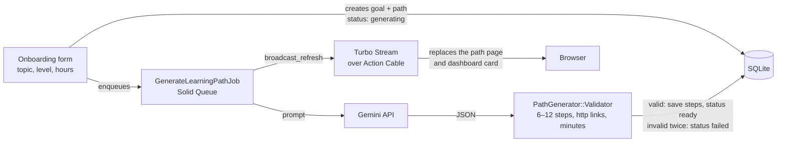

# 🚀 Path Aviator

[](https://github.com/MeghaKoshti/path-aviator/actions/workflows/ci.yml)

**Path Aviator is an AI-powered learning planner built with Ruby on Rails 8.** Tell it what you want to learn, your current level and the hours you have each week. It plans a step-by-step route of courses, docs, videos, articles and practice, then tracks your progress as you tick steps off.


## Status

| Area | Status |
|---|---|
| Rails 8 app setup (Solid Queue, Solid Cache, Solid Cable, Kamal) | ✅ Done |
| Authentication (Rails 8 built-in: sessions, password reset) | ✅ Done |
| Design system, landing page and app shell (Tailwind CSS) | ✅ Done |
| Sign-up, with first-time users sent to onboarding | ✅ Done |
| Three-step onboarding (topic, level, weekly hours and goal) | ✅ Done |
| AI path generation (Gemini, background job, live Turbo Stream updates) | ✅ Done |
| Progress tracking: tick steps, % complete, time left, "Continue" | ✅ Done |
| Dashboard of all your paths | ✅ Done |
| Weekly stats: time against your goal, days learned, streak | ✅ Done |
| Path management: try again, regenerate, delete | ✅ Done |
| Account settings: profile, password, delete account | ✅ Done |
| Private notes on each step, edited in place | ✅ Done |
| Public read-only share links for a path (turn off any time) | ✅ Done |
| Accessibility (WCAG 2.1 AA checks, keyboard) and responsive pass | ✅ Done |
| CI: tests, system tests, RuboCop, Brakeman, importmap audit | ✅ Done |
| Privacy, terms, refund and contact pages, sign-up consent | ✅ Done (needs owner review) |
| Pricing page (INR/USD, monthly/yearly toggle, FAQ) and job-switch landing copy | ✅ Done |
| Google / GitHub sign-in | 📝 Planned |

## Screenshots

<table>
  <tr>
    <td width="50%"><b>Landing</b><br></td>
    <td width="50%"><b>Dashboard</b><br></td>
  </tr>
  <tr>
    <td><b>Learning path</b><br></td>
    <td><b>Shared path</b><br></td>
  </tr>
  <tr>
    <td><b>Step notes</b><br></td>
    <td><b>Onboarding</b><br></td>
  </tr>
  <tr>
    <td><b>Generating</b><br></td>
    <td><b>Settings</b><br></td>
  </tr>
  <tr>
    <td><b>Sign up</b><br></td>
    <td><b>Sign in</b><br></td>
  </tr>
  <tr>
    <td colspan="2" align="center"><b>Mobile</b><br></td>
  </tr>
</table>

## Tech stack

| Layer | Technology |
|---|---|
| Backend | Ruby on Rails 8.1 |
| Auth | Rails 8 authentication generator (`has_secure_password`, sessions) |
| Frontend | Hotwire (Turbo Frames, Turbo Streams, Stimulus) with Importmap |
| Styling | Tailwind CSS (`tailwindcss-rails`) |
| AI | Google Gemini API (JSON mode), validated before saving |
| Database | SQLite |
| Background jobs | Solid Queue |
| Real-time updates | Action Cable with Solid Cable |
| Caching | Solid Cache |
| Assets | Propshaft + Thruster |
| Deployment | Kamal (Docker) |

## How it works



1. Onboarding saves a learning goal and a path in the `generating` state, queues `GenerateLearningPathJob` and opens the path page. That page subscribes to the user's Turbo Stream.
2. The job asks Gemini for a strict JSON plan. `PathGenerator::Validator` checks it: 6 to 12 steps, required fields, a known resource type, http(s) links and positive minutes. A bad answer gets one retry. After that the path is marked `failed` with a friendly message and a "Try again" button.
3. When the job finishes, it broadcasts the re-rendered path partial. The page swaps from the planning animation to the route without a reload, and a polite live region tells screen reader users.
4. Ticking a step sends a `PATCH` and gets back Turbo Streams that update the route, the progress panel and the time left. Counter caches keep the dashboard to a fixed number of queries.
5. Each step has a private note, edited in place inside a Turbo Frame (Esc cancels). The dashboard's "This week" panel works out time against the weekly goal and the streak from when steps were ticked.
6. Sharing gives a path a random token and a public, `noindex` page at `/p/:token` with the steps and progress only. "New link" swaps the token and "Stop sharing" clears it, so old links 404.

Without a `GEMINI_API_KEY` (and always in tests), a built-in fake generator returns a realistic sample path, so the whole flow works offline.

## Getting started

### Prerequisites

- Ruby 3.3 (see `.ruby-version`)
- No Node.js needed (Importmap + `tailwindcss-rails`)

### Setup

```bash
git clone git@github.com:MeghaKoshti/path-aviator.git
cd path-aviator

bin/setup --skip-server   # bundle install + db:prepare
bin/rails db:seed         # demo account with two sample paths

bin/dev                   # Rails server + Tailwind watcher
```

Open http://localhost:3000 and sign in with the demo account:

| Email | Password |
|---|---|
| `demo@pathaviator.dev` | `pathaviator-demo` |

The demo account is shared, so its name, email and password can't be changed, it can't be deleted, and password reset emails are never sent for it. Everything else (planning paths, notes, ticking steps, sharing) works as for any account.

### Background jobs

- **Development:** jobs run inside the Rails server (Active Job `:async` adapter), so `bin/dev` is all you need. Live updates use the in-process Action Cable adapter.
- **Production:** jobs run on Solid Queue. `config/deploy.yml` sets `SOLID_QUEUE_IN_PUMA=true` so one container serves web and jobs. To run a separate worker, use `bin/jobs`.

### AI generation (optional)

| Variable | Purpose |
|---|---|
| `GEMINI_API_KEY` | Enables real path generation with Google Gemini. Leave it unset to use the built-in sample generator. |
| `GEMINI_MODEL` | Model name, defaults to `gemini-2.5-flash`. |

```bash
GEMINI_API_KEY=your-key bin/dev
```

### Run tests and checks

```bash
bin/rails test            # models, controllers, jobs, views
bin/rails test:system     # browser tests in headless Chrome
bin/rubocop
bin/brakeman --no-pager
bin/importmap audit
```

System tests use headless Chrome, and Selenium finds a matching driver by itself. To use a specific Chrome or Chromium build, point the tests at it:

```bash
CHROME_BIN=/path/to/chrome CHROMEDRIVER_PATH=/path/to/chromedriver bin/rails test:system
# add CHROME_NO_SANDBOX=1 when running as root, e.g. inside a container
```

## Policy pages: review before launch

> **⚠️ Megha must read and adjust these before taking payments. They are a plain-English starting point, not legal advice.**

`/privacy`, `/terms`, `/refunds` and `/contact` are written for an individual operator in India (DPDP Act 2023 and DPDP Rules 2025 notice basics, GDPR basics) with these subprocessors: Google Gemini API, Hetzner (hosting), Resend (email) and Dodo Payments (merchant of record). Before launch:

- Set `LEGAL_OWNER_NAME` and `SUPPORT_EMAIL`. Until both are set, every policy page shows a "Placeholder details" warning.
- Check the commitments match how you run things: 7-day first-payment refund, 3-day grace after a failed payment, 30-day backup deletion, replies within 2 working days, grievances acknowledged in 3 working days.
- Confirm the Gemini key is on the paid tier (the privacy page says prompts aren't used for training), and that the hosting region and email provider match the table.
- Bump `Legal::LAST_UPDATED` (`app/models/legal.rb`) whenever the wording changes.

## Deploy

Path Aviator runs as one Docker container on one small VPS, deployed with [Kamal 2](https://kamal-deploy.org). The container serves the app with Puma behind Thruster and runs the Solid Queue jobs inside Puma (`SOLID_QUEUE_IN_PUMA`). The SQLite databases live on a persistent Docker volume. `kamal-proxy` in front handles HTTPS with a free Let's Encrypt certificate and only sends traffic to a new version once `/up` answers.

Nothing server-specific is committed: `config/deploy.yml` reads the server, registry and domain from your shell, and `.kamal/secrets` reads the secrets from your shell.

### 1. What you need

- A VPS with Ubuntu 24.04, 1–2 GB RAM and your SSH key, for example a Hetzner Cloud CX22 or a DigitalOcean Basic droplet. Allow ports 22, 80 and 443 in its firewall. Kamal installs Docker on it for you.
- A domain or subdomain you can add DNS records to.
- A container registry account: Docker Hub with an [access token](https://docs.docker.com/security/for-developers/access-tokens/), or GitHub's `ghcr.io` with a token that has `write:packages`.
- Docker on your own machine (Kamal builds the `amd64` image there; on Apple Silicon this is emulated and slower).
- `config/master.key`. If you don't have it, run `rm config/credentials.yml.enc && bin/rails credentials:edit` to create a new key; the app keeps nothing else in credentials.

### 2. Point your domain at the server

Add an `A` record, for example `pathaviator.example.com → 203.0.113.10`, and wait until `dig +short pathaviator.example.com` shows the server's IP. Let's Encrypt checks this during the first deploy. On Cloudflare, use "DNS only" (grey cloud) or set SSL/TLS to "Full".

### 3. Set the environment

| Variable | Required | Used by | What it is |
|---|---|---|---|
| `KAMAL_SERVER_IP` | Yes | `deploy.yml` | The VPS's public IP address |
| `KAMAL_REGISTRY_USERNAME` | Yes | `deploy.yml` | Registry user; the image is pushed as `<user>/path_aviator` |
| `KAMAL_REGISTRY_PASSWORD` | Yes | secret | Registry access token |
| `KAMAL_REGISTRY_SERVER` | No | `deploy.yml` | Registry host, e.g. `ghcr.io`. Docker Hub when unset |
| `APP_HOST` | Yes | `deploy.yml`, app | Your domain: the HTTPS certificate, links in emails and Rails host checks |
| `RAILS_MASTER_KEY` | Yes | secret | Contents of `config/master.key` |
| `GEMINI_API_KEY` | No | secret | Real AI generation. Without it the built-in sample generator is used |
| `SEED_DEMO` | No | app | `1` creates the public demo account and resets it on every boot and every night. Default `0`: no demo account in production |
| `DEMO_EMAIL` | No | app | Sign-in email of the demo account. Defaults to `demo@pathaviator.dev` |
| `SMTP_ADDRESS`, `SMTP_PORT`, `SMTP_USERNAME` | No | app | Outgoing email for password resets. Port defaults to 587 |
| `SMTP_PASSWORD` | No | secret | SMTP password or API key |
| `MAILER_FROM` | No | app | Sender address. Defaults to `Path Aviator <no-reply@APP_HOST>` |
| `LEGAL_OWNER_NAME` | Yes, before launch | app | Your legal name, shown as the operator and grievance officer on the policy pages |
| `SUPPORT_EMAIL` | Yes, before launch | app | The monitored support and grievance address shown on the policy and contact pages |

Keep them in a file that git ignores (the `/.env*` rule covers `.env.deploy`) and load it before each Kamal command:

```bash
# .env.deploy (never commit this file)
export KAMAL_SERVER_IP=203.0.113.10
export KAMAL_REGISTRY_USERNAME=your-docker-hub-user
export KAMAL_REGISTRY_PASSWORD=your-access-token
export APP_HOST=pathaviator.example.com
export RAILS_MASTER_KEY=$(cat config/master.key)
export GEMINI_API_KEY=your-gemini-key   # optional
export SEED_DEMO=1                      # optional: public demo
```

```bash
source .env.deploy
```

### 4. First deploy

```bash
bin/kamal setup
```

This installs Docker on the server, builds and pushes the image, starts `kamal-proxy`, gets the certificate and boots the app. On boot, `bin/docker-entrypoint` runs `db:prepare` (plus `db:seed` when `SEED_DEMO=1`). Check it:

```bash
curl https://pathaviator.example.com/up   # 200 when the app is healthy
bin/kamal smoke                            # one real Gemini call, nothing saved
```

### 5. The demo account

In production the demo account (`demo@pathaviator.dev` / `pathaviator-demo`) is opt-in, so a private install never gets a login everyone knows. Deploy with `SEED_DEMO=1` to create it and reset it on every boot, or run `bin/kamal seed` to create or reset it once.

With `SEED_DEMO=1`, `ResetDemoAccountJob` also runs every night at 3am UTC (`config/recurring.yml`): progress, notes and sharing go back to the seeded state, and paths visitors added are deleted. Visitors can't lock others out: the demo account's settings (name, email, password, deletion) are refused by the server, and a password reset request for it sends nothing.

To remove it later (and unset `SEED_DEMO`):

```bash
bin/kamal console
User.find_by(email_address: DemoAccount.email)&.destroy
```

### 6. Day to day

| Command | What it does |
|---|---|
| `bin/kamal deploy` | Ship the committed code (Kamal builds from the current git commit) |
| `bin/kamal logs` | Follow the app logs |
| `bin/kamal console` | Rails console on the server |
| `bin/kamal rollback <version>` | Go back to an earlier image (see `bin/kamal app images`) |

Everything the app stores is in the `path_aviator_storage` volume (`/var/lib/docker/volumes/path_aviator_storage/_data` on the server). Turn on your provider's server backups, or copy a consistent snapshot with `bin/kamal app exec --reuse "sqlite3 storage/production.sqlite3 '.backup storage/backup.sqlite3'"` and download it.

### Try the production image locally

```bash
docker build -t path_aviator .
docker run --rm -p 8080:80 -e SECRET_KEY_BASE=$(openssl rand -hex 64) -e SOLID_QUEUE_IN_PUMA=true -e SEED_DEMO=1 path_aviator
curl http://localhost:8080/up
```

## Author

**Megha Koshti**, Ruby on Rails developer · [GitHub](https://github.com/MeghaKoshti) · [LinkedIn](https://www.linkedin.com/in/megha-koshti)

## License

[MIT](LICENSE)
