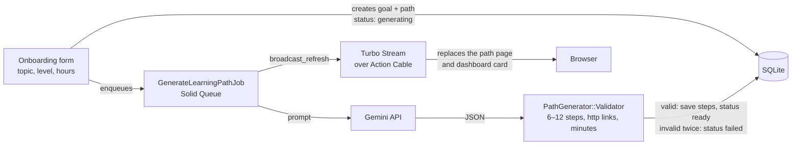

# 🚀 Path Aviator

[](https://github.com/MeghaKoshti/path-aviator/actions/workflows/ci.yml)

**Path Aviator is an AI-powered learning planner built with Ruby on Rails 8.** Tell it what you want to learn, your current level and the hours you have each week. It plans a step-by-step route of courses, docs, videos, articles and practice, then tracks your progress as you tick steps off.


## Status

| Area | Status |
|---|---|
| Rails 8 app setup (Solid Queue, Solid Cache, Solid Cable, Kamal) | ✅ Done |
| Authentication (Rails 8 built-in: sessions, password reset) | ✅ Done |
| Design system, landing page and app shell (Tailwind CSS) | ✅ Done |
| Sign-up, with first-time users sent to onboarding | ✅ Done |
| Three-step onboarding (topic, level, weekly hours and goal) | ✅ Done |
| AI path generation (Gemini, background job, live Turbo Stream updates) | ✅ Done |
| Progress tracking: tick steps, % complete, time left, "Continue" | ✅ Done |
| Dashboard of all your paths | ✅ Done |
| Weekly stats: time against your goal, days learned, streak | ✅ Done |
| Path management: try again, regenerate, delete | ✅ Done |
| Account settings: profile, password, delete account | ✅ Done |
| Private notes on each step, edited in place | ✅ Done |
| Public read-only share links for a path (turn off any time) | ✅ Done |
| Accessibility (WCAG 2.1 AA checks, keyboard) and responsive pass | ✅ Done |
| CI: tests, system tests, RuboCop, Brakeman, importmap audit | ✅ Done |
| Google / GitHub sign-in | 📝 Planned |

## Screenshots

<table>
  <tr>
    <td width="50%"><b>Landing</b><br></td>
    <td width="50%"><b>Dashboard</b><br></td>
  </tr>
  <tr>
    <td><b>Onboarding</b><br></td>
    <td><b>Learning path</b><br></td>
  </tr>
  <tr>
    <td><b>Generating</b><br></td>
    <td><b>Settings</b><br></td>
  </tr>
  <tr>
    <td><b>Sign up</b><br></td>
    <td><b>Sign in</b><br></td>
  </tr>
  <tr>
    <td colspan="2" align="center"><b>Mobile</b><br></td>
  </tr>
</table>

## Tech stack

| Layer | Technology |
|---|---|
| Backend | Ruby on Rails 8.1 |
| Auth | Rails 8 authentication generator (`has_secure_password`, sessions) |
| Frontend | Hotwire (Turbo Frames, Turbo Streams, Stimulus) with Importmap |
| Styling | Tailwind CSS (`tailwindcss-rails`) |
| AI | Google Gemini API (JSON mode), validated before saving |
| Database | SQLite |
| Background jobs | Solid Queue |
| Real-time updates | Action Cable with Solid Cable |
| Caching | Solid Cache |
| Assets | Propshaft + Thruster |
| Deployment | Kamal (Docker) |

## How it works



1. Onboarding saves a learning goal and a path in the `generating` state, queues `GenerateLearningPathJob` and opens the path page. That page subscribes to the user's Turbo Stream.
2. The job asks Gemini for a strict JSON plan. `PathGenerator::Validator` checks it: 6 to 12 steps, required fields, a known resource type, http(s) links and positive minutes. A bad answer gets one retry. After that the path is marked `failed` with a friendly message and a "Try again" button.
3. When the job finishes, it broadcasts the re-rendered path partial. The page swaps from the planning animation to the route without a reload, and a polite live region tells screen reader users.
4. Ticking a step sends a `PATCH` and gets back Turbo Streams that update the route, the progress panel and the time left. Counter caches keep the dashboard to a fixed number of queries.

Without a `GEMINI_API_KEY` (and always in tests), a built-in fake generator returns a realistic sample path, so the whole flow works offline.

## Getting started

### Prerequisites

- Ruby 3.3 (see `.ruby-version`)
- No Node.js needed (Importmap + `tailwindcss-rails`)

### Setup

```bash
git clone git@github.com:MeghaKoshti/path-aviator.git
cd path-aviator

bin/setup --skip-server   # bundle install + db:prepare
bin/rails db:seed         # demo account with two sample paths

bin/dev                   # Rails server + Tailwind watcher
```

Open http://localhost:3000 and sign in with the demo account:

| Email | Password |
|---|---|
| `demo@pathaviator.dev` | `pathaviator-demo` |

### Background jobs

- **Development:** jobs run inside the Rails server (Active Job `:async` adapter), so `bin/dev` is all you need. Live updates use the in-process Action Cable adapter.
- **Production:** jobs run on Solid Queue. `config/deploy.yml` sets `SOLID_QUEUE_IN_PUMA=true` so one container serves web and jobs. To run a separate worker, use `bin/jobs`.

### AI generation (optional)

| Variable | Purpose |
|---|---|
| `GEMINI_API_KEY` | Enables real path generation with Google Gemini. Leave it unset to use the built-in sample generator. |
| `GEMINI_MODEL` | Model name, defaults to `gemini-2.5-flash`. |

```bash
GEMINI_API_KEY=your-key bin/dev
```

### Run tests and checks

```bash
bin/rails test            # models, controllers, jobs, views
bin/rails test:system     # browser tests in headless Chrome
bin/rubocop
bin/brakeman --no-pager
bin/importmap audit
```

System tests use headless Chrome, and Selenium finds a matching driver by itself. To use a specific Chrome or Chromium build, point the tests at it:

```bash
CHROME_BIN=/path/to/chrome CHROMEDRIVER_PATH=/path/to/chromedriver bin/rails test:system
# add CHROME_NO_SANDBOX=1 when running as root, e.g. inside a container
```

## Author

**Megha Koshti**, Ruby on Rails developer · [GitHub](https://github.com/MeghaKoshti) · [LinkedIn](https://www.linkedin.com/in/megha-koshti)

## License

[MIT](LICENSE)
